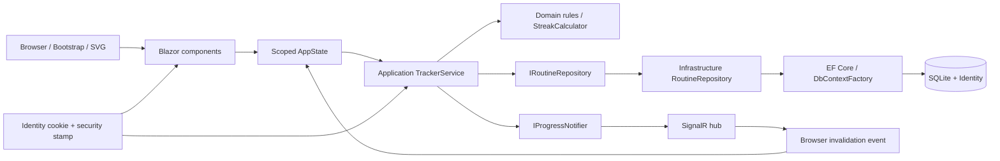

# HabitFlow — Interactive Habit & Workout Progress Tracker

Готовое решение Blazor Web App на .NET 8: конструктор привычек и тренировок, серии, графики, журнал и социальный рейтинг с добровольным участием. Полный исходный код находится в `src/`, тесты — в `tests/`. Для работы приложения не нужны Node.js, Docker, облачная БД, внешние API или CDN.

## Обзор, цель и задачи

**Цель:** помочь человеку регулярно выполнять небольшие, измеримые действия и видеть накопленный результат.

**Задачи:** создавать персональные программы по дням недели; задавать упражнения, подходы и повторения; записывать время и личные заметки; вычислять текущие и лучшие серии; сравнивать активность за 7/14/28 дней; поддерживать ответственность через месячный рейтинг; обеспечивать безопасный доступ пользователей и администраторов.

**Практическая значимость:** один интерфейс объединяет тренировки и повседневные привычки; дни отдыха не разрывают серии, архив сохраняет историю, а публичность профиля выбирает сам участник. Приложение не требует платных сервисов.

## Точная структура решения

```text
HabitFlow/
├── HabitFlow.sln
├── global.json
├── Directory.Build.props
├── .config/dotnet-tools.json
├── src/
│   ├── HabitFlow.Domain/
│   │   ├── Routine.cs                   # Routine, RoutineStep, CheckIn, RoutineKind
│   │   └── StreakCalculator.cs
│   ├── HabitFlow.Application/
│   │   ├── Contracts.cs                 # DTO, команды, интерфейсы, исключения
│   │   └── TrackerService.cs            # Проверки и сценарии приложения
│   ├── HabitFlow.Infrastructure/
│   │   ├── AppUser.cs
│   │   ├── AppDbContext.cs
│   │   ├── DesignTimeDbContextFactory.cs
│   │   ├── RoutineRepository.cs
│   │   ├── AdminService.cs
│   │   ├── DatabaseSeeder.cs
│   │   └── Migrations/                  # InitialCreate + snapshot модели
│   └── HabitFlow.Web/
│       ├── Program.cs
│       ├── appsettings.json
│       ├── Properties/launchSettings.json
│       ├── Services/                    # Identity, AppState, Toast, SignalR
│       ├── Components/
│       │   ├── App.razor
│       │   ├── Routes.razor
│       │   ├── Layout/MainLayout.razor
│       │   ├── Pages/                   # Четыре страницы + общий Workspace, Settings, Admin, Login, Register
│       │   └── Shared/                  # Карточки, графики, формы, модальные окна
│       └── wwwroot/                     # Локальные Bootstrap/SignalR, CSS, JS, favicon
├── tests/
│   ├── HabitFlow.Tests/                 # xUnit, SQLite, bUnit, WebApplicationFactory
│   └── e2e/                            # Playwright + axe, четыре конфигурации браузера
└── docs/                               # Архитектура, схема, рубрика, защита, QA
```

## Технологии: сравнение и обоснование

| Область | Выбор | Альтернатива | Причина |
|---|---|---|---|
| UI | Blazor Interactive Server | WebAssembly / React | Общий C# стек, быстрая SSR-загрузка, серверная авторизация; нужен устойчивый канал связи |
| Платформа | .NET 8 LTS | .NET Framework | Кроссплатформенность и требование задания; для эксплуатации после окончания поддержки 10.11.2026 следует планировать переход на поддерживаемую версию |
| Данные | EF Core 8 + SQLite | PostgreSQL / SQL Server | Автоматическое создание файла и миграции на Windows/macOS/Linux; для большого числа одновременных записей лучше серверная БД |
| Идентификация | ASP.NET Core Identity + cookie | Самописный JWT | Хеширование паролей, роли, блокировки, security stamp и защита cookie средствами платформы |
| UI-набор | Bootstrap 5.3.9 + собственные стили | MudBlazor | Небольшой объём зависимостей, локальные ресурсы, адаптивные формы |
| Графики | Доступный SVG-компонент | Chart.js / ApexCharts | Без сетевой загрузки и лицензирования сервиса, таблица-альтернатива для чтения данных |
| Состояние | Scoped AppState + события | Fluxor / глобальный singleton | Отдельный контейнер на circuit пользователя, простые подписки и контролируемая сериализация операций |
| Live updates | ASP.NET Core SignalR | Опрос таймером | Уведомление после фиксации записи, автоматическое переподключение, обновление нескольких клиентов |
| Проверки | xUnit + bUnit + Playwright + axe | Только ручное тестирование | Раздельная проверка правил, реальной SQLite, компонентов, HTTP и пользовательских сценариев |

## Архитектура и поток данных



Зависимости проектов направлены внутрь: `Domain ← Application ← Infrastructure`, а `Web` является composition root и ссылается на Application/Infrastructure. Domain не зависит от EF или Blazor. Сервисы используют интерфейсы и DTO; репозиторий возвращает агрегаты только Application, UI получает DTO.

`EditForm → EventCallback → AppState.MutateAsync → TrackerService → Repository → SaveChangesAsync → SignalR → AppState.RefreshAsync → Changed → StateHasChanged`.

Контейнер состояния сериализует обновления с `SemaphoreSlim`; ошибки сохраняют последнюю успешную модель. Подписки компонентов и JS-ссылки удаляются при уничтожении; каждый запрос репозитория создаёт и освобождает свой контекст. Для Identity зарегистрирован отдельный scoped-контекст, а серверная проверка текущего пользователя читает свежие данные через фабрику.

Подробные UML и схема: [ARCHITECTURE.md](docs/ARCHITECTURE.md), [DATABASE.md](docs/DATABASE.md).

## Установка и запуск

### Требования

Установите **актуальный доступный .NET 8 SDK** с https://dotnet.microsoft.com/download/dotnet/8.0. Команда `dotnet --info` должна показывать SDK 8.0.x. `global.json` разрешает актуальный feature band 8.0. ОС: Windows, macOS или Linux. При первом restore нужен доступ к NuGet.

### Windows, macOS и Linux

Распакуйте архив, откройте терминал в каталоге с `HabitFlow.sln`:

```sh
dotnet restore HabitFlow.sln
dotnet build HabitFlow.sln --no-restore
dotnet test HabitFlow.sln --no-build
dotnet run --project src/HabitFlow.Web
```

Откройте **http://localhost:5080**. Профиль `Properties/launchSettings.json` включает Development. На первом старте автоматически применится `InitialCreate` и будут созданы демонстрационные пользователи, 15 программ и несколько сотен записей за последние 42 дня. Повторный старт не дублирует данные. База: `src/HabitFlow.Web/App_Data/habitflow.db`.

Для другого порта:

```sh
dotnet run --project src/HabitFlow.Web --urls http://localhost:5090
```

IDE: откройте `HabitFlow.sln` в Visual Studio 2022 с ASP.NET workload, Rider или VS Code с C# Dev Kit; запускаемый проект — `HabitFlow.Web`. Node.js нужен только для E2E-тестов.

### Тестовые аккаунты — только Development

| Роль | Email | Пароль |
|---|---|---|
| Admin + User | admin@habitflow.local | Demo!Pass123 |
| User | user@habitflow.local | Demo!Pass123 |
| User | maya@habitflow.local | Demo!Pass123 |
| User | noah@habitflow.local | Demo!Pass123 |
| User | sara@habitflow.local | Demo!Pass123 |

Регистрация создаёт только роль `User`, профиль по умолчанию закрыт. Клиент не может назначить себе Admin.

## Руководство пользователя

1. **Overview:** оцените сегодняшние программы, лучшую текущую серию, минуты за семь дней и очки месяца. Карточка программы содержит описание, расписание и раскрываемые упражнения.
2. **My routines → New routine:** введите название, описание, тип, минуты и дни недели. При необходимости добавьте до 20 упражнений с подходами и повторениями. Расписание после первой отметки фиксируется, чтобы история серий не менялась задним числом.
3. **Check in:** запишите дату, время и личную заметку. Допустим прошедший запланированный день не старше года и не раньше даты создания программы. За один день принимается одна отметка на программу.
4. **Progress:** меняйте диапазон графика 7/14/28 дней, раскрывайте таблицу, смотрите лучшие серии и журнал. `Log an entry` позволяет добавить пропущенную запись; `Undo` удаляет ошибочную отметку и пересчитывает очки/серии.
5. **Archive / Restore:** скрывайте ненужные программы без удаления истории. Архивные программы не принимают новые отметки.
6. **Settings:** измените отображаемое имя и включите участие в рейтинге. Другим видны только имя и месячные итоги; email и заметки в рейтинг не попадают.
7. **Community:** 10 очков за каждую отметку, одинаковый вес у коротких и длинных занятий. Итоги сбрасываются с началом месяца по времени Астаны (UTC+5); сохранённая история остаётся. Рейтинг ограничен 100 участниками, ничьи упорядочиваются по имени, затем ID.
8. **Administration:** администратор видит до 500 аккаунтов и может временно приостановить/восстановить доступ обычного пользователя. Самоблокировка и блокировка администраторов запрещены сервером. При блокировке меняется security stamp; старый сеанс потребует повторного входа после восстановления.
9. **Live:** откройте две сессии одного пользователя; запись в одной обновит другую. При отключении SignalR показывается статус переподключения, а при потере circuit — ссылка перезагрузки.

**Правила серий:** учитываются только запланированные дни начиная с создания программы. Незавершённый сегодняшний день ещё не разрывает вчерашнюю серию. Пропущенный более ранний запланированный день разрывает. Лучший результат рассчитывается по всей истории. Все даты используют время Астаны (UTC+5).

## Тесты

```sh
dotnet test HabitFlow.sln
dotnet test HabitFlow.sln --collect:"XPlat Code Coverage" --results-directory TestResults
```

Сервисные тесты используют настоящую SQLite в памяти с применением миграции, не EF InMemory. HTTP-тесты запускают приложение в TestServer с отдельным временным файлом БД. Сценарии и результаты перечислены в [QA.md](docs/QA.md).

Для E2E сначала запустите приложение в Development на порту 5080, затем в другом терминале:

```sh
cd tests/e2e
npm ci
npx playwright install chromium firefox
npm test
```

Linux при нехватке системных библиотек: `npx playwright install --with-deps chromium firefox`. Альтернативный порт: задайте переменную `HABITFLOW_URL`. Уже установленный Chromium можно использовать через `CHROMIUM_PATH`. В Windows PowerShell: `$env:HABITFLOW_URL="http://localhost:5090"`; в bash: `export HABITFLOW_URL=http://localhost:5090`.

E2E изменяют только Development-данные: создают уникальные тестовые аккаунты и программы. Выполняйте их на отдельной локальной базе. Отчёт: `tests/e2e/playwright-report/index.html`. Проверки устройств эмулируют viewport и ввод; это не проверка на физических телефонах.

## Миграции и разработка

```sh
dotnet tool restore
dotnet ef migrations add DescribeChange --project src/HabitFlow.Infrastructure
dotnet ef migrations list --project src/HabitFlow.Infrastructure
```

`DesignTimeDbContextFactory` предназначена только для инструментов; runtime получает строку подключения из конфигурации. Миграции выполняются на старте приложения, `EnsureCreated` в runtime не используется. Структура БД, индексы и ограничения описаны в `docs/DATABASE.md`.

## Production и эксплуатация

```sh
dotnet publish src/HabitFlow.Web -c Release -o publish
```

Запускайте из каталога `publish`, укажите `ASPNETCORE_ENVIRONMENT=Production`, `AllowedHosts` с реальным доменом, HTTPS-сертификат Kestrel и постоянный доступный на запись каталог `App_Data`. Настройка через переменные среды поддерживает двойное подчёркивание, например `ConnectionStrings__DefaultConnection`.

Первый администратор создаётся при наличии `Bootstrap__AdminEmail` и `Bootstrap__AdminPassword` в защищённой конфигурации процесса. Пароль должен удовлетворять политике Identity; значения не храните в исходниках. После создания удалите bootstrap-пароль из окружения. Если email уже зарегистрирован, startup не повышает его роль. Development-аккаунты в Production автоматически не создаются; используйте отдельную production-БД.

Пример HTTPS-запуска после настройки переменных `ASPNETCORE_Kestrel__Certificates__Default__Path` и `ASPNETCORE_Kestrel__Certificates__Default__Password`:

```sh
dotnet HabitFlow.Web.dll --urls https://0.0.0.0:5443
```

Production-cookie: Secure, HttpOnly, SameSite=Lax, срок 8 часов. Формы защищены antiforgery; endpoints входа/регистрации ограничены по частоте; 5 неверных паролей вызывают блокировку на 15 минут. Запросы приложений повторно проверяют владельца, блокировку и security stamp; состояние circuit перепроверяется каждую минуту. `ErrorBoundary` скрывает исключения UI, production middleware обрабатывает серверные ошибки. Сохранённые записи не отменяются из-за сбоя доставки SignalR.

Сохраняйте резервные копии SQLite и ключей Data Protection (`App_Data/keys`). Для согласованного копирования SQLite остановите приложение или используйте SQLite backup API; не копируйте только основной файл при активном WAL. Ключи локально сохраняются как файлы; защищайте права каталога и используйте доступное хосту шифрование хранилища. Перед изменением схемы создайте backup. Приложение рассчитано на один экземпляр: одновременно запускать несколько автоматических миграторов нельзя. EF-миграции при большом развёртывании следует выполнять отдельным шагом релиза.

**Границы масштабирования:** SQLite — файловая БД с сериализацией записей; Blazor Server хранит состояние circuit в памяти. Для нескольких серверов понадобятся серверная БД, общие ключи Data Protection, SignalR scale-out и affinity. UI виртуализирует журнал, рейтинг агрегируется и ограничивается SQL, число программ ограничено 100 на workspace. Полная личная история загружается на один workspace для точного расчёта lifetime-серий: при многолетних больших объёмах следует вынести агрегаты/историю в постраничные запросы. Лимит программ проверяется приложением и не является строгой конкурентной квотой БД.

В заданный объём не входят отправка email, восстановление пароля, MFA и offline-редактирование. Их необходимо добавить перед использованием в сценарии, который требует этих функций. Готовность конкретного хостинга, резервного копирования и эксплуатационной политики должна проверяться при развёртывании; локальные тесты не являются аудитом инфраструктуры.

## Материалы для университета

- [Соответствие 20 критериям](docs/RUBRIC.md)
- [Архитектура и UML](docs/ARCHITECTURE.md)
- [Схема базы данных](docs/DATABASE.md)
- [План защиты на 15–20 минут](docs/DEFENSE.md)
- [Проверки и подтверждённые результаты](docs/QA.md)

Входной DOCX использован как справочная рубрика. Участники, ФИО и организационные сведения должны быть добавлены авторами перед защитой; приложение не содержит вымышленных сведений об исполнителях.

## Обновление: Астана, тема и командная работа

Демонстрационные имена: Ayan Sapar, Arman Nurlan, Aruzhan Serik, Dias Alikhan, Aigerim Bolat. Email/пароли тестовых аккаунтов сохранены для совместимости. На старой Development-БД заменяются только исходные английские демонстрационные имена; пользовательские имена не перезаписываются.

Календарь отметок, серий и рейтинга использует Astana UTC+5, независимо от часов сервера. Ранее сохранённые календарные даты не сдвигаются. Security timestamps и блокировки Identity остаются в UTC.

Кнопка Light / Dark в верхней панели переключает тему; выбор сохраняется в браузере и применяется также к странице входа.

Инструкция для двух участников: **docs/TEAM_GITHUB.md**. Загрузка в GitHub автоматически не выполнялась.

При обновлении своей копии сохраните папку src/HabitFlow.Web/App_Data: там база и ключи. Замените исходники, остановите старый процесс и запустите проект заново. Для стилей при необходимости выполните Ctrl+F5.

## Цели и достижения

Settings → Weekly check-in goal задаёт цель от 1 до 100 отметок. Она хранится в AspNetUsers.WeeklyGoal. Неделя — понедельник–воскресенье по Астане; при смене цели текущий прогресс пересчитывается, а с новым понедельником отсчёт начинается заново. Отметки привычек и тренировок учитываются одинаково.

Overview и Progress показывают недельный прогресс, остаток до цели, активные дни и минуты. Достижения: первая отметка, 10 отметок, лучшая серия 7 запланированных дней, 300 минут за всё время. Награды вычисляются по текущей личной истории, включая архивные программы; Undo может снова заблокировать награду. Дополнительные очки за награды не начисляются.

AddWeeklyGoal — дополнительная EF-миграция: существующие аккаунты получают цель 5, записи пользователя сохраняются. Перед обновлением сохраняйте резервную копию App_Data.

Для демонстрации: зарегистрировать аккаунт, установить цель 1, выполнить программу — увидеть 100% и First step, отменить отметку — увидеть пересчёт. Правила находятся в ProgressInsights.cs; хранение — в AppUser/RoutineRepository; UI — WeeklyGoalCard/AchievementsPanel; тесты — InsightsTests и goals.spec.ts.
