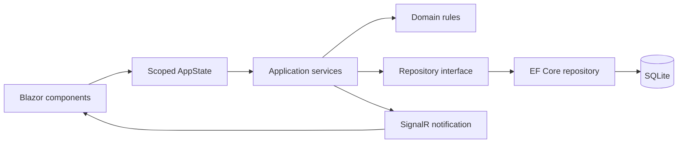
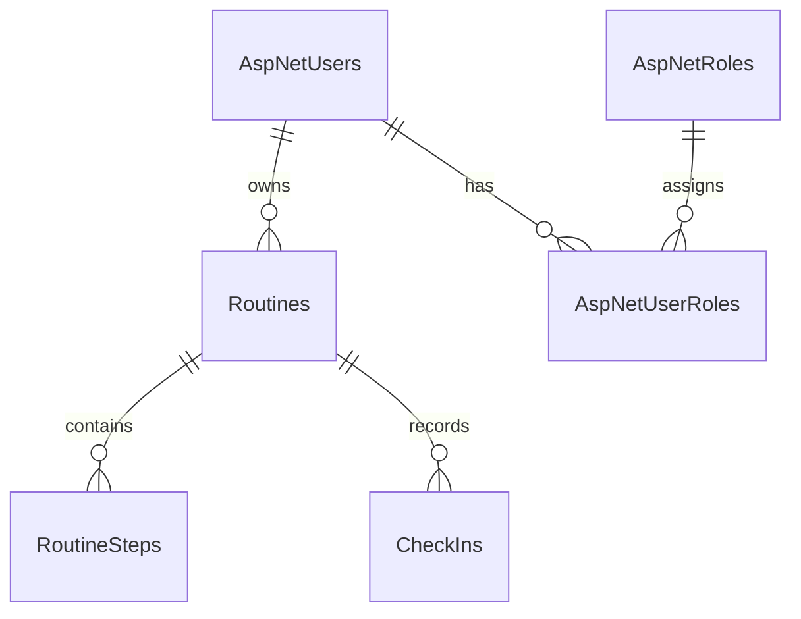

# HabitFlow

HabitFlow is a habit and workout tracker built with Blazor and .NET 8. It brings routines, daily check-ins and workout exercises into one place, with weekly goals and a shared leaderboard for accountability.

The aim is to make consistency visible: users can see what they completed, where a streak stopped and how their current week compares with their target.

## Features

- Create habits or workouts with a weekly schedule and a target duration.
- Add exercises with sets and repetitions to a routine.
- Record a check-in with minutes spent and a private note. Undo an incorrect entry from the activity journal.
- Track current and best streaks. Scheduled rest days do not break a streak.
- Set a weekly check-in goal and follow it on the dashboard.
- Earn milestones for a first check-in, 10 check-ins, a seven-day scheduled streak and 300 minutes of activity.
- View activity charts for 7, 14 or 28 days and a 28-day calendar.
- Join the monthly leaderboard by making a profile public. Private notes and routine details stay private.
- Switch between light and dark themes. The browser remembers the choice.
- Use the Admin page to suspend or restore standard accounts.

Check-ins, weeks and leaderboard months use **Astana time (UTC+5)**. A week runs from Monday to Sunday. Security timestamps, such as account lockout expiry, use UTC.

## Run locally

Install the [.NET 8 SDK](https://dotnet.microsoft.com/download/dotnet/8.0). Check the installed SDKs with `dotnet --list-sdks`; an `8.0.x` version must be available. Node.js is only needed for the browser tests.

Extract the project and open a terminal in the folder containing `HabitFlow.sln`:

```sh
dotnet restore HabitFlow.sln
dotnet run --project src/HabitFlow.Web
```

Open **http://localhost:5080**. Keep the terminal running while using the app. Press Ctrl+C to stop it.

The included launch profile selects Development. On the first run, EF Core applies the migrations and creates demo accounts, routines and activity history. SQLite runs inside the application, so there is no separate database server to install.

### Visual Studio

Open `HabitFlow.sln`, set `HabitFlow.Web` as the startup project and select the `HabitFlow` launch profile. Run with F5 or Ctrl+F5. Install the ASP.NET and web development workload and .NET 8 SDK if prompted.

### VS Code

Use **File → Open Folder** to open the folder containing the solution, then run the commands above in **Terminal → New Terminal**. Microsoft's C# Dev Kit extension provides C# editing and debugging support. Live Server is not used.

## Demo accounts

These accounts are created in **Development only**. Their display names are the names shown in the app and leaderboard.

| Display name | Email / login | Role |
|---|---|---|
| Ayan Sapar | `ayan@habitflow.local` | Admin and User |
| Arman Nurlan | `arman@habitflow.local` | User |
| Aruzhan Serik | `aruzhan@habitflow.local` | User |
| Dias Alikhan | `dias@habitflow.local` | User |
| Aigerim Bolat | `aigerim@habitflow.local` | User |

All demo accounts use the password **`Demo!Pass123`**. The `.local` addresses are test logins, not working email inboxes.

New registrations receive the User role and start with a private profile. Users can change their display name, weekly target and leaderboard visibility in Settings.

When upgrading an older Development database, the seeder changes the original demo email addresses to the ones above while keeping the account IDs and their activity. Sign in again using the updated email if an old session expires. Custom display names are preserved.

## Using the app

1. Open **My routines → New routine**. Choose a type, duration and days of the week. Exercises are optional.
2. Select **Check in** after completing a routine. A routine accepts one check-in per scheduled day. Backdated entries are allowed within the last year, starting from the routine's creation date.
3. Open **Progress** for the journal, charts and best streaks. Use **Undo** to remove an incorrect check-in.
4. Set **Weekly check-in goal** in Settings. Changing the target updates the current week's progress.
5. Enable **Join the community leaderboard** to share your display name and monthly totals with signed-in users.

Each check-in earns 10 leaderboard points. Entering more minutes does not earn extra points. Milestones are calculated from the current history; undoing a check-in can lock a milestone again. Archived routines keep their history and earned points but cannot receive new entries until restored.

A routine's schedule and type become fixed after its first check-in. This prevents later edits from changing the meaning of earlier streaks. An unfinished today does not break yesterday's streak, but a missed earlier scheduled day does.

For a short demo, create an account, set its weekly goal to 1 and complete a routine. The dashboard reaches 100% and unlocks First step. Undo the entry to show both values being recalculated.

## Stack and design choices

| Part | Choice | Reason |
|---|---|---|
| UI | Blazor Interactive Server | C# components, server-side access checks and a small browser client. It requires a live connection for interactions. |
| Styling | Bootstrap 5 and local CSS | Responsive forms and layouts, with local assets and a custom light/dark theme. |
| Storage | EF Core 8 with SQLite | Runs on Windows, macOS and Linux without setting up a database service. PostgreSQL would be a better fit for many concurrent writers. |
| Accounts | ASP.NET Core Identity | Password hashing, roles, lockout and cookie authentication provided by the framework. |
| Updates | SignalR | Connected clients reload their authorized view after a change rather than polling on a timer. |
| Charts | Razor and SVG | Enough for the activity charts used here; exact values are also available in a table. |
| Tests | xUnit, bUnit and Playwright | Separate checks for service rules, storage, components and browser interactions. |

.NET 8 is the target required by the project. For deployment after its support end date, plan an upgrade to a supported .NET release.

## Project structure

```text
src/
  HabitFlow.Domain/          Entities, Astana calendar and streak calculation
  HabitFlow.Application/     DTOs, interfaces, validation and progress calculations
  HabitFlow.Infrastructure/  Identity, EF Core, repositories, migrations and seeding
  HabitFlow.Web/             Blazor pages, components, state and SignalR
tests/
  HabitFlow.Tests/           xUnit, SQLite integration, HTTP and bUnit tests
  e2e/                      Playwright browser tests
docs/                       Database, architecture, QA and team notes
```

Dependencies point towards the core: Domain has no EF Core or Blazor dependency; Application defines the interfaces; Infrastructure implements storage. Web wires the services together through dependency injection.



A form submits a DTO through an EventCallback. AppState serializes operations and raises its Changed event when data is refreshed. Services check the current user and validate the operation before the repository writes it. A SignalR event then tells connected clients to refresh; it contains no private notes or routine details.

Reusable components include RoutineCard, ProgressChart, WeeklyGoalCard, AchievementsPanel and ModalShell. The activity journal uses Virtualize. Repository operations create and dispose their own DbContext, and components remove subscriptions when disposed.

## Database

The local database is stored at:

```text
src/HabitFlow.Web/App_Data/habitflow.db
```



Identity stores the accounts and roles. Routines contain the schedule and exercise steps; CheckIns store dates, minutes and notes. A unique index on `(RoutineId, Date)` prevents duplicate daily entries. An integer revision detects competing edits. WeeklyGoal is stored on the user; weekly totals, streaks and milestones are calculated from the activity history.

Migrations run on startup. `InitialCreate` sets up the original schema and `AddWeeklyGoal` adds the weekly target, defaulting to 5 for existing accounts.

Before replacing a local installation, back up `App_Data`. It contains the database and Data Protection keys. Do not commit this directory to GitHub.

## Tests

```sh
dotnet build HabitFlow.sln
dotnet test HabitFlow.sln
dotnet test HabitFlow.sln --collect:"XPlat Code Coverage"
```

The .NET suite contains 49 test cases covering rules, real SQLite storage, authorization, state and component behavior. The browser tests also cover registration, check-ins, undo, visibility, weekly goals and live updates. Version-specific results and limits are recorded in [docs/QA.md](docs/QA.md); older coverage figures there belong to their recorded version.

To run the browser tests, start the app in Development first. In a second terminal:

```sh
cd tests/e2e
npm ci
npx playwright install chromium firefox
npm test
```

The default test URL is `http://127.0.0.1:5080`. Set `HABITFLOW_URL` to use another address. Use a separate Development database: the tests create accounts and routines.

## Working together

The backend work is grouped under Domain, Application and Infrastructure. The frontend work is under Web, with tests and documentation alongside it. Each contributor should use their own GitHub account and review the files included in each commit.

If both contributors work directly on `main`, pull before starting:

```sh
git switch main
git pull origin main
```

Commit the files you worked on, then push to `main`. Coordinate edits to shared files before working on them. The `.gitignore` excludes local databases, keys, build output and node_modules.

## Deployment notes

Publish the server application with:

```sh
dotnet publish src/HabitFlow.Web -c Release -o publish
```

Use a host that supports ASP.NET Core and WebSockets, with HTTPS and persistent writable storage. GitHub Pages cannot run the Interactive Server backend.

Set `ASPNETCORE_ENVIRONMENT=Production`, configure the public host in `AllowedHosts`, and provide the server's HTTPS configuration. Development accounts are not created in Production. A first administrator can be created through `Bootstrap__AdminEmail` and `Bootstrap__AdminPassword` in protected environment configuration; remove the bootstrap password after setup.

This version is intended for one application instance. Multiple servers would require shared Data Protection keys, SignalR scale-out and a database suitable for concurrent writers. The app loads a user's full activity history to calculate lifetime streaks; larger installations should add paginated history and stored aggregates. Email delivery, password recovery, MFA and offline editing are outside the current scope.

Further architecture, database and team notes are available in `docs`; most of those supporting documents are in Russian.
