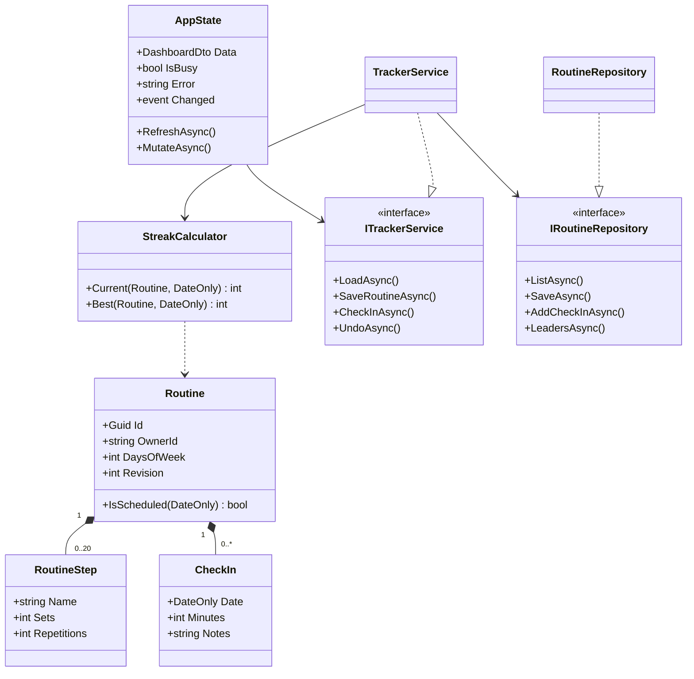
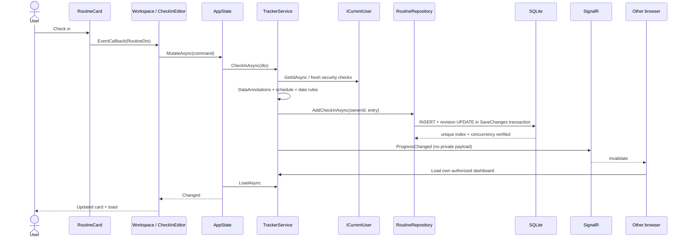

# Архитектура и UML

## Направление зависимостей

## Успешная отметка и синхронизация

## SOLID и время жизни

| Принцип | Реализация |
|---|---|
| SRP | StreakCalculator вычисляет серии, TrackerService выполняет сценарии, Repository сохраняет, компоненты рисуют |
| OCP | IProgressNotifier/IRoutineRepository можно заменить без изменения сценариев |
| LSP | Реализации интерфейсов соблюдают единый контракт DTO/исключений |
| ISP | Отдельные ITrackerService, IAdminService, ICurrentUser, IProgressNotifier |
| DIP | Application зависит от портов, реализации подключаются DI в Program.cs |

AppState и ToastService — scoped, изолированы на Blazor circuit. TimeProvider и потокобезопасный SignalR publisher — singleton. Репозиторий создаёт DbContext на операцию. Клиентские подписки снимаются в Dispose/IAsyncDisposable; native dialog возвращает фокус, ловит Escape и ограничивает клавиатурный фокус. Журнал использует Virtualize.

## Решения и компромиссы

- Interactive Server уменьшает клиентский bundle и держит работу с БД на сервере; сеть нужна для действий пользователя.
- Свой SVG проще тяжёлой библиотеки для одной временной серии; таблица сохраняет доступность точных данных.
- Расписание фиксируется после первой отметки: изменение сегодня не переписывает исторические ожидания.
- Очки равны 10 за запись: введённые минуты не дают преимущества в соревновании.
- События SignalR сообщают лишь факт изменения. Каждый клиент читает собственные данные через проверку владельца. На большом числе клиентов широковещательную инвалидизацию следует заменить группами и отдельной инвалидизацией публичного рейтинга.
- SQLite поддерживает реальную уникальность и транзакции без отдельной установки; ревизия целочисленная, поскольку SQLite не имеет SQL Server rowversion.
- `SaveChangesAsync` атомарно изменяет ревизию программы и запись. Конкурентный архив/редактирование вызывает конфликт, дубль даты — ошибку ограничения. Автоматический повтор записи без проверки не выполняется.
- Удаление программы заменено обратимым архивом, чтобы сохранять историю. Исправление ежедневной записи выполняется Undo и повторным check-in.
