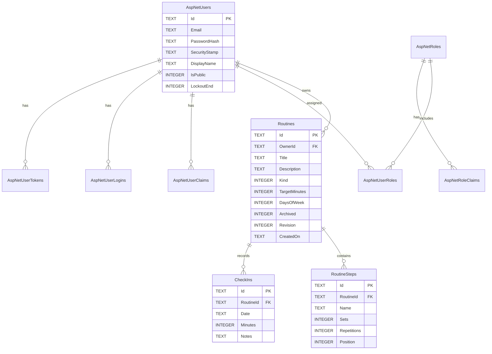

# Схема SQLite

`InitialCreate` создаёт прикладные и стандартные таблицы Identity. EF Core использует GUID как TEXT, DateOnly как TEXT в формате ISO, bool/int как INTEGER. LockoutEnd хранится UTC ticks (INTEGER), что позволяет сравнивать блокировки на стороне SQLite.

| Таблица | Ключи и ограничения |
|---|---|
| Routines | PK Id; FK OwnerId → AspNetUsers.Id ON DELETE CASCADE; индекс (OwnerId, Archived); CHECK TargetMinutes 1..600, DaysOfWeek 1..127; Revision — concurrency token |
| RoutineSteps | PK Id; FK RoutineId → Routines.Id ON DELETE CASCADE; CHECK Sets 1..30, Repetitions 1..500; Position задаёт порядок |
| CheckIns | PK Id; FK RoutineId → Routines.Id ON DELETE CASCADE; UNIQUE (RoutineId, Date); индекс Date; CHECK Minutes 1..600 |
| AspNetUsers | стандартные поля Identity + DisplayName до 40 и IsPublic; уникальное нормализованное имя; уникальность email проверяется Identity |
| AspNetRoles | стандартная роль с уникальным NormalizedName; Admin и User |
| AspNetUserRoles | составной PK (UserId, RoleId), два FK |
| AspNetUserClaims, AspNetRoleClaims | стандартные claims |
| AspNetUserLogins, AspNetUserTokens | стандартные составные ключи Identity |
| __EFMigrationsHistory | журнал применённых миграций |

Длина заголовков 2..80, описаний до 500, заметок до 300, названий упражнений до 80 проверяется Application. SQLite не ограничивает длину TEXT по HasMaxLength автоматически, поэтому проверка выполняется на сервере. Пользовательские ID берутся из проверенного principal, а не из команд браузера.

Маска дней: Sunday=1, Monday=2, Tuesday=4, Wednesday=8, Thursday=16, Friday=32, Saturday=64. Every day=127, Monday/Wednesday/Friday=42.

Дата создания отделена от timestamp: приложение последовательно использует календарь Астаны (UTC+5). Поля check-in не содержат копию OwnerId — владение устанавливается через родительскую Routine. Сумма очков вычисляется из фактических записей месяца, отдельной изменяемой таблицы очков нет.

## Дополнительная миграция AddWeeklyGoal

AspNetUsers.WeeklyGoal: INTEGER NOT NULL DEFAULT 5, CHECK 1..100. Хранится только целевое число отметок; недельные итоги и достижения вычисляются по CheckIns и истории серий, поэтому таблица наград не нужна. Начало недели определяется в ProgressInsights по календарю Астаны.
